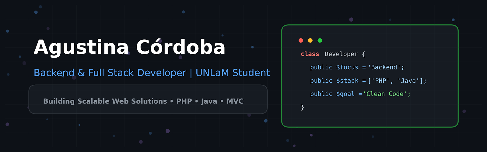

  <!-- BANNER PRINCIPAL -->
  

    

  <!-- TYPING ANIMATION -->
  

  

    <b>Estudiante de Desarrollo Web en la UNLaM</b> enfocada en el desarrollo Backend, diseño de software escalable y buenas prácticas.
  

### 👩‍💻 Sobre mí

- 🎓 **Educación:** Estudiando la *Tecnicatura Universitaria en Desarrollo Web* en la **UNLaM**.
- ⚡ **Enfoque Actual:** Desarrollando una plataforma de **E-commerce** orientada a comercios de productos importados, optimizada para ventas locales y distribución nacional.
- 🧠 **Metodologías:** Aplicación de Programación Orientada a Objetos (**POO**), principios **SOLID**, patrones de diseño y pruebas unitarias con **TDD / JUnit**.
- 🛠️ **Objetivo:** Construir soluciones backend sólidas, limpias y preparadas para escalar.

---

### 💻 Tech Stack & Herramientas

| Categoría | Tecnologías / Herramientas |
| :--- | :--- |
| **Lenguajes** |      |
| **Frameworks & Motores** |    |
| **Bases de Datos & Servidores** |   |
| **Arquitectura & Diseño** | `Arquitectura MVC` • `Principios SOLID` • `Patrones de Diseño` • `TDD` • `UML` |
| **Entornos & Herramientas** |      |

---

### 🚀 Proyecto Principal en Desarrollo

#### 🛍️ [E-Commerce Web Platform](https://github.com/agustinacordoba-dev/ecommerce)
> **Sistema Web de Comercio Electrónico orientado a Tiendas de Productos Importados**

- **Descripción:** Solución e-commerce completa diseñada para integrarse a la venta tradicional en local físico y expandir canales de comercialización a clientes de todo el país.
- **Arquitectura Backend:** Construida sobre una **arquitectura MVC pura (Framework custom nativo)** desarrollada para maximizar el rendimiento, el control de ruteo y la comprensión profunda de patrones web en PHP.
- **Features Clave:**
  - 🛒 **Catálogo Interactivo:** Filtrado eficiente y navegación de productos importados.
  - 🛍️ **Carrito & Check-out:** Gestión en tiempo real de ordenes y pasarela de pago.
  - 📊 **Panel Administrativo (CMS):** Control de stock, inventario, ventas y generación de reportes clave.
  - 🎨 **Frontend Dinámico:** Plantillado optimizado mediante **Mustache, CSS modular y JS**.
- **Tech Stack:** `PHP` • `Mustache` • `MySQL` • `JavaScript` • `CSS3`

---
